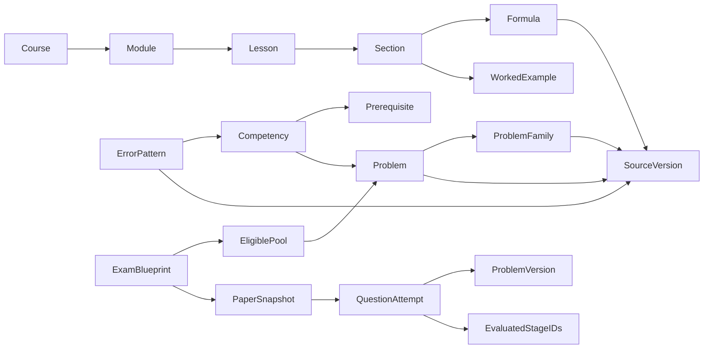

# CurriculumRegistry и расширение программы

Текущий статус версии и внешнего выпуска: [PROJECT_STATUS](PROJECT_STATUS.md). Эта архитектура входит в v0.4.0; фактические CI и размещение проверяются отдельно по точному SHA и build-info. Авторизация выпуска — в [процессе](PUBLIC_RELEASE_PROCESS.md).

## Модель

Основные типы находятся в `src/curriculum/types.ts`, адаптер существующего корпуса — в `index.ts`, exact-version approval — в `review-ledger.ts`. Старое название `content.topics` сохраняется как совместимый каталог глав; реестр отдельно моделирует настоящий модуль темы3 и вложенные уроки. ID темы и ID её урока не обязаны совпадать; несколько уроков одного будущего модуля проверяются настоящим renderer-тестом.

Секции и примеры имеют составные стабильные ID; формулы и задачи имеют семантические версии. Ссылки ведут на существующие формулы, разделы, source versions и семейства. Источники преподавателя остаются private bibliographic references без public PDF-ссылок. Внешнее пояснение IAS7/IFRS18 явно отделено от лекционных фактов и имеет версионированные HTTPS-ссылки на публичные обзоры IFRS Foundation.

## Приёмка контента

`DRAFT → SOURCE_REVIEW → FINANCE_REVIEW → PEDAGOGICAL_REVIEW → PUBLISHED` — последовательность приёмки. Переходы нельзя перескочить через `nextReviewStage`. Итоговый ledger — явный результат bounded independent review, а не функция «существует файл». Отдельно проверяются точные версии уроков, формул и задач. Тест изменения версии на99.0.0 доказывает, что прежнее approval не переносится на новую версию.

Staging — типизированные состояния и проверка последовательности переходов при подготовке контента. В поставляемой статической сборке trusted ledger уже содержит итоговые принятые версии, а адаптер отражает доступность как DRAFT/PUBLISHED; отдельного workflow-сервера и защищённого журнала согласований нет. Supporting receipts сохраняются в аудитном пакете.

Ledger не является криптографической подписью преподавателя. Его изменение, как и изменение контента, требует review и сохранённых supporting bytes. Внутреннее `PUBLISHED` открывает контент в локальной сборке; публичный Git/Pages переход отдельно требует owner authorization.

`registryFindings` проверяет уникальность, версии, отсутствующие зависимости, циклы компетенций, согласованность parent/child и семейств, доступность предков и формул. `contentLinkFindings` дополнительно проверяет реальные practice/section/formula/stage links и числовые контракты, включая поддержку каждой эталонной единицы фактическим unitPolicy. Эти проверки вызываются при загрузке Vite config, поэтому повреждённый граф блокирует build.

Компетенции представлены группами главы и более точными узлами определений/формул; они не равны числу независимых человеческих навыков. ErrorPattern имеет версию, объявленные competencies и источник авторской taxonomy; family объединяет source versions своих задач. Широкая applicability taxonomy не является диагнозом причины ошибки. У неизвестной исторической версии автоматическое связывание с текущей компетенцией может отсутствовать; snapshot и оценка сохраняются.

Error Log связывает наблюдаемую ошибку с текущей версией и формульным кластером, сохраняя исторический snapshot. Категории timing/interpretation можно отметить самому; программа не выводит смысловую причину из одного неверного числа.

## Контрольные

`ExamBlueprint` задаёт темы, компетенции, допустимые сложности/типы, веса источников и компетенций, лимит времени и политику unseen history. Допустимый пул включает только согласованные reviewed ID/версии; unavailable предки, формулы и неподтверждённые версии исключены. Эквивалентные вопросы объединяются в family; например, старый benchmark консолидации и новый самостоятельный случай не попадают в один вариант.

Сборка детерминирована при одинаковых blueprint/version, seed, reviewed pool и истории показов. Сохраняются сам blueprint, seed, точные ID/версии/families/source versions и история до открытия. Сборщик использует constrained matching; его результат проверен независимым перебором малых графов. При `require` невозможный unseen-вариант завершается явным отказом. При `prefer` сначала ищется полностью unseen matching; если он невозможен, разрешён mixed fallback. Его состав сохраняется и не объявляется полностью новым. Веса задают предпочтение, не точные квоты; mixed fallback не гарантирует глобально максимальное число unseen задач.

40-вопросный теоретический тест имеет фиксированный полный состав: seed не создаёт ещё40 новых компетенций или новые данные. Короткие варианты и интеграционные papers выбирают из проверенных семейств. Точное время — учебное ограничение; человеческий темп и формат реальной КР ещё не откалиброваны.

Локальный таймер блокирует ввод по истечении времени, разбор появляется после отправки. Это учебная симуляция в браузере, не защищённая экзаменационная среда. Сессия при повторе/восстановлении архивируется; retry не теряет паспорт и не превращает timed paper в безымянную старую попытку.

## Совместимость и будущая тема

Сохраняются прежние hash routes (`#/learn/T3-07` и разделы), ID вопросов и schema1. `AnswerRecord` хранит problem/version, точные evaluated stage IDs, unit/grading protocol и snapshot; новые версии не переоценивают старые ответы. Импорт сопоставляет ID/версию с собственным историческим snapshot; присутствующие современные assessed IDs должны быть уникальны, существовать в snapshot и точно соответствовать stageResults. Старый optional формат остаётся допустимым, текущий банк для переоценки не используется. Опциональные `paper` и `errorReviews` валидируются при импорте; повреждённый импорт не перезаписывает исходные bytes.

Для следующей реальной темы: проверить новый private PDF/Excel → записать source identity/version → внести typed module/lessons/competencies в staging → проверить DAG/assets/crosslinks → независимо принять текст и эталоны → внести конкретные версии в ledger → собрать новый reviewed blueprint. Количество тем и семестров заранее не фиксируется. Runtime AI, сервер и внешняя загрузка заданий не добавлены.

`future-topic-ui.test.ts` создаёт непубликуемую синтетическую тему4 только в изолированной памяти теста: два разных lesson ID, две настоящие ссылки и разные названия в renderer. После теста исходный каталог восстанавливается; в shipped curriculum только реальная тема3. Другой тест проверяет, что draft будущей темы скрыт. Изменений UI source для этой проверки не требуется.
